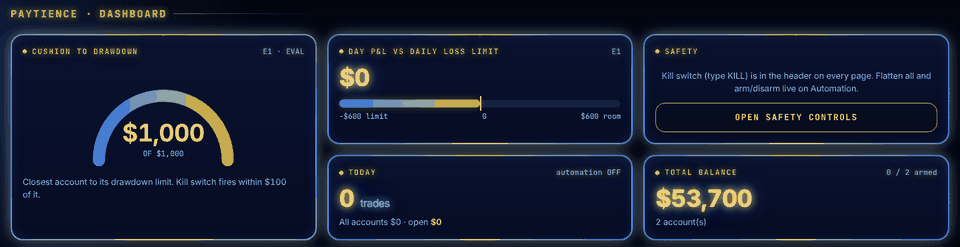
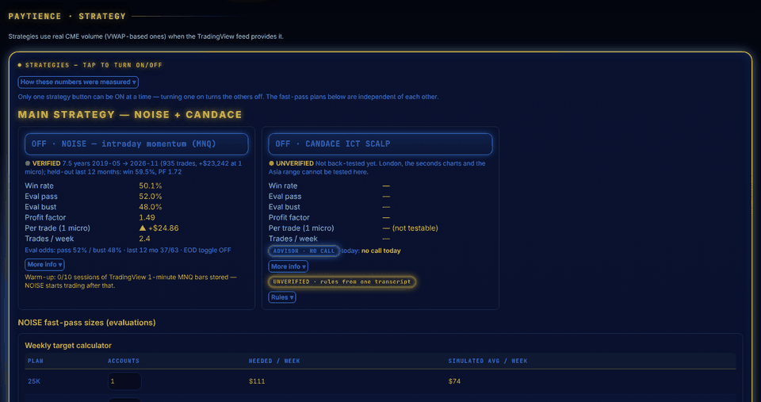
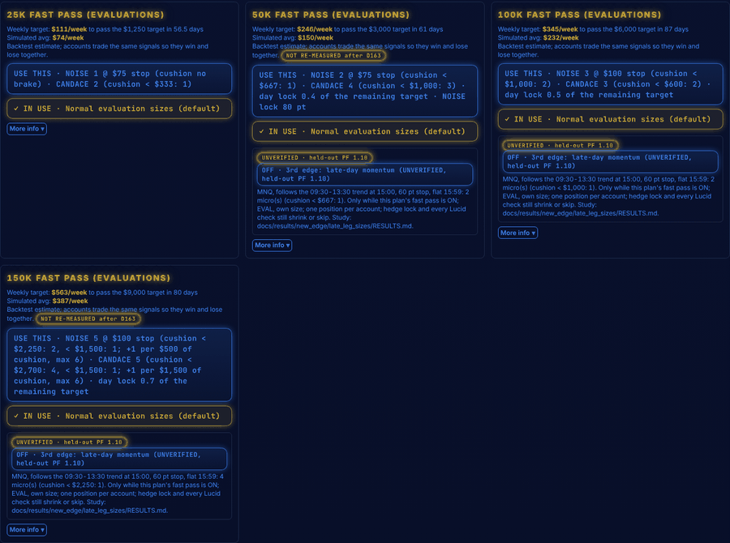
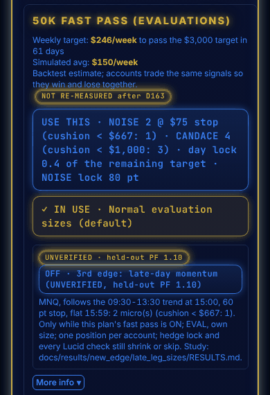
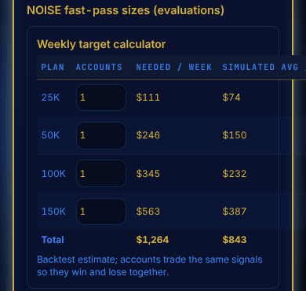
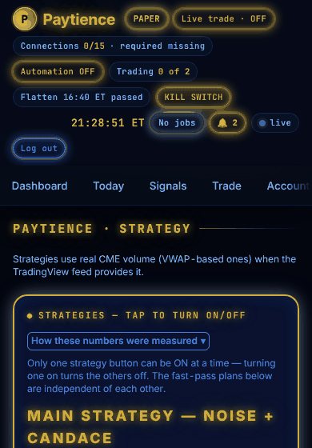

# UI visual design review: Strategy, Dashboard, Today (2026-11-24)

Read-only review. No app code was changed. Scope: `frontend/src/pages/{Strategy,Dashboard,Today}.tsx`, shared components,
`lib/theme.ts`, and the four global stylesheets loaded in this order: `index.css` → `mission.css` (D93) → `finish.css`
(D117) → `variants.css`. **Neon is the default look** (D124, `style-switch.ts:6`), so everything below was judged in Neon.

**How it was rendered.** `npm ci && npm run build` passed. The real backend ran with the same recipe as `make e2e`
(`frontend/e2e/full.mjs`): a throwaway SQLite DB, a temporary admin, the scheduler off, and two paper accounts (E1 EVAL,
F-sweep FUNDED) created through the real API. No mock data was used. Playwright + Chromium took the screenshots at
deviceScaleFactor 1, at 1440×900 and 390×844, and probed computed styles (font sizes, text colours, overflow, running
animations). The harness script lives only in the scratchpad and was not committed.

---

## Verdict in one paragraph

The §18 basics hold. Every page has the right tab title, the "PAYTIENCE · <PAGE>" label, ▲/▼ with a sign on P&L, and
red/green only as dots. The Dashboard bento is the strongest screen in the app. The Strategy page is the weakest, for
five reasons. (1) `blue #3B82F6` is the most-used text colour on the page and falls below AA on the tinted button and
nav surfaces. (2) In Neon, section headings are larger and heavier than the page title, so the hierarchy is inverted.
(3) Three different ON/OFF treatments are in use. (4) The four fast-pass cards sit in a 3-column grid, wrap 4–6-line
monospaced button labels, and repeat the same disclaimer five times. (5) Neon runs **98 infinite animations** on the
Strategy page. On a phone, the Strategy page is **14,837 px tall** (about 17.5 screens), the weekly-calculator table is
clipped, and the header takes about 205 px before the nav.

---

## What already works well (keep it)

- **§18 compliance holds in the rendered pages, not just in the code.** Computed text colours on all three pages are only
  `#D4AF37` / `#F2D27A` / `#3B82F6` / `#93C5FD` / `#FFC93C`. Red and green appear only on `●` glyphs (20 red, 2 green on
  Strategy). Tab titles were checked: "Paytience · Strategy", "Paytience · Dashboard", "Paytience · Today".
- **Dashboard bento (`MissionBento.tsx`).** It has a clear focal point (the cushion gauge), big tabular numbers, a single
  gold CTA ("Open safety controls") and good grouping. This is the visual language the rest of the app should converge on.
  
- **Mandatory checklist.** The gold-family `mandatory #FFC93C` (11–13:1) is distinct without breaking §18. The two-column
  rows with a status chip and a one-line reason scan well.
- **Badge unification in `finish.css:144-151`.** Every inline `span.rounded.border.border-gold` (UNVERIFIED, VERIFY,
  NOT RE-MEASURED, MLL LOCKED, GUARD) renders as the same mono pill. The rough Tailwind in the components is normalised in
  one place.
- **The pick-one wording "✓ IN USE / USE THIS"** (D141) is unambiguous and is announced through `aria-pressed`.
- **Accessibility plumbing.** There is a goldLight `:focus-visible` ring everywhere (12.9:1).
  `prefers-reduced-motion` turns all motion off (`index.css:213`, `finish.css:223`). There is no page-level horizontal
  scroll at 390 px. The phone dock (`MobileDock.tsx`) works, and loading skeletons are in place.
- **The token tests** (`lib/theme.test.ts`) plus a rendered-page contrast E2E (`e2e/full.mjs:355`) are a better base than
  most apps have. They just need to see gradients (issue 2).

---

## Ranked issues

Severity: **P1** = accessibility failure, or something users will misread. **P2** = hierarchy or consistency that costs
scanning time. **P3** = polish.

### 1. P1: `blue #3B82F6` used as body text and as the OFF/USE-THIS label fails AA on tinted surfaces

- Evidence: 419 text nodes on Strategy compute to `rgb(59,130,246)`. On the blue-tinted outline button
  (`finish.css:123`: `rgba(blue,.14)` over the Neon tile, about `#11224C`) the ratio is **4.21:1**. On the gold/10 pick
  button it is **4.30:1**, on `navOn` **3.78:1**, and on the Classic glass card **4.47:1**. These are 14–16 px semibold,
  which is not "large text", so the bar is 4.5:1.
- Where: `StrategyButtons.tsx:207` (`border-blue text-blue`, "OFF · NOISE …"), `:251`, `:349`, `:360`, `:415`, `:432`
  ("USE THIS …"), and about 40 `text-xs text-blue` paragraphs (`:220`, `:226`, `:256`, `:377`, `:441`, `:454` …).
  Also `Strategy.tsx:46,51`, `Today.tsx:120`, `FlagToggle.tsx:43`, and the Dashboard projection notice and footer.
- Fix (theme tokens only): keep `blue` for borders, links and focus. Use `blueLight` for text that sits on any tint.

```css
/* finish.css, after line 123 — outline buttons: blue border, blueLight label (8.58:1 on the tint) */
.mission main button.border-blue:not([class*="bg-"]) { color: #93C5FD; }
/* secondary prose: blueLight at 78 % (≈6.3:1 on the Neon tile) instead of #3B82F6 (4.2–5.0:1) */
.mission main :is(p, li, dd, span).text-blue { color: rgba(147, 197, 253, .78); }
```

  Before: `className="… border-blue text-blue"` → after: `className="… border-blue text-blueLight"`. Do this at the
  component level once the CSS has proven it.

### 2. P1 (test gap): the rendered-contrast E2E cannot see this

- `e2e/full.mjs:360-368` (`bgOf`) composites only `backgroundColor`. It ignores `background-image` (every button tint
  and every Neon card is a gradient) and element `opacity`. That is why issue 1 passes CI. `theme.test.ts:6-15` checks
  only the flat `bg` / `card` / `#070C19` surfaces.
- Fix: in `bgOf`, when `backgroundImage` contains `rgba(...)`, composite its **first** stop over the base (the top of a
  180° gradient is the worst case). Multiply the foreground alpha by the product of ancestor `opacity`. In
  `theme.test.ts`, add `blue` vs `#11224C` (blue/14 tint) and vs `mission.navOn`. That test fails today, which is the
  point.

### 3. P2: hierarchy inversion in Neon (section headings outrank the page title)

- `variants.css:123-124` makes `h1` 0.95 rem (15.2 px) and makes **every `h3`** uppercase, weight 800, tracked .14em,
  with a gold glow (`:122`). "MAIN STRATEGY — NOISE + CANDACE" (`StrategyButtons.tsx:380`, `text-lg` = 18 px) is
  therefore louder than "PAYTIENCE · STRATEGY". Card titles inside the fast-pass cards (`:335`, h3) shout at the same
  level. Meanwhile `h4` (`:384`) and `h5` (`:510`) stay sentence case at 14–15 px, so the four heading levels read
  2-1-3-3. 
- The same inversion shows on Dashboard account cards: `Dashboard.tsx:75` renders the title "E1" as an 11.2 px eyebrow,
  and its subtitle span "EVAL · APP PAPER · disarmed" at 14 px, so the subtitle is larger than the title.
- Type sizes in use: Strategy uses 9 sizes (10.24, 10.56, 11.2, 12, 14, 15, 15.2, 16.96, 18 px) and Dashboard uses 13.
  Several of them are within 1 px of each other.
- Fix: one scale in `finish.css:10` beside the existing `--s-*` spacing tokens.

```css
:root { --fs-chip: .6875rem; --fs-eyebrow: .6875rem; --fs-sm: .75rem; --fs-body: .875rem; --fs-h3: 1rem; --fs-h1: 1rem; --fs-kpi: 2.25rem; }
html[data-style="neon"] .mission main h1 { font-size: var(--fs-h1); }                   /* was .95rem */
html[data-style="neon"] .mission main h3 { text-transform: none; letter-spacing: -.005em; font-weight: 650;
  font-size: var(--fs-h3); text-shadow: none; }                                         /* was uppercase/800/glow */
.mission main span.rounded.border, .mission main span.rounded-full.border { font-size: var(--fs-chip); } /* was .64rem = 10.24px */
```

  Dashboard.tsx:75: before `<span className="text-sm font-normal text-blue">` → after `<span className="tile-aside">`.
  That class already exists (`mission.css:60`) and the bento uses it.

### 4. P2: three different ON/OFF treatments for the same idea

| Where | ON looks like | OFF looks like |
|---|---|---|
| Strategy buttons `StrategyButtons.tsx:207` | gold outline, **no fill, no ✓**, "ON · …" | blue outline + blue tint, "OFF · …" |
| Pick-one / late-day `:349`, `:360`, `:415`, `:432` | `pick-in-use bg-gold/10`, **✓**, "✓ IN USE" / "✓ ON" | blue outline, "USE THIS" / "OFF" |
| Gate flags `FlagToggle.tsx:43` | small gold outline, "ON" | small blue outline, "OFF" |

- The main strategy button's ON state is the weakest of the three, yet it is the most important switch on the page. OFF
  uses the interactive blue, which makes OFF look more clickable and more "active" than ON.
- Fix: one ON style and one OFF style everywhere. ON = `pick-in-use border-gold bg-gold/10 text-gold` with the label
  "✓ ON". OFF = a neutral `border-border text-blueLight` plus the existing blue hover. Keep `aria-pressed` as it is.

### 5. P2: fast-pass cards (first-priority area)



- **Grid:** four cards in `lg:grid-cols-3` (`StrategyButtons.tsx:386`) leave the 150K card orphaned on row 2. Heights
  also differ by up to 2× (25K has no late-day block). Fix: `grid gap-3 md:grid-cols-2 2xl:grid-cols-4`, plus
  `h-full flex flex-col` on the card with `mt-auto` on "More info".
- **Long monospaced button labels:** `mission.css:64` and `finish.css:117` put every `button.rounded-md` in JetBrains
  Mono. The fast-pass "USE THIS · NOISE 5 @ $100 stop (cushion < $2,250: 2, …)" label wraps to **6 lines** of
  monospaced text. Fix: `.mission main button.text-left { font-family: var(--f-body); letter-spacing: 0; }`. Better
  still, split the label into a bold first line ("Fast-pass sizes") and a `text-xs` detail line.
- **Badge placement:** VERIFY sits in the title (`:335`), but NOT RE-MEASURED is appended inline to the end of a paragraph
  (`:340`). There, the Neon ring (`variants.css:129`, `0 0 0 2px` plus glow) overlaps the line above.
  
  Fix: render it in the `h3` beside VERIFY, so every status badge sits in the title row.
- **Repetition:** "Backtest estimate; accounts trade the same signals so they win and lose together." appears in the
  calculator (`:525`) and in every card (`:340`), five times in total. Keep it once, under the calculator.
- **Duplicated info:** the late-day block shows an "UNVERIFIED · held-out PF 1.10" badge (`:357`) and then a button whose
  server-provided label repeats "(UNVERIFIED, held-out PF 1.10)" (`:361`). Drop it from one place, preferably the
  label.
- **Nesting depth:** section card (`p-4`) → card (`p-3`) → late-day box (`p-2`) gives three bordered layers. On a
  390 px phone that costs 72 px of width. Make the late-day box a top-border divider (`border-t border-border pt-2`)
  instead of a third box.

### 6. P2: phone density and overflow

- **Weekly calculator clipped:** its table (`StrategyButtons.tsx:511`) is 440 px wide inside a 390 px viewport and has
  no scroll wrapper, so "SIMULATED AVG / WEEK" is cut off. `DrawdownCompareView` already does this right (`:109`).
  
  Before: `<table className="mt-1 w-full …">` → after: wrap it in `<div className="overflow-x-auto">`, with headers
  "Need / wk" and "Sim / wk".
- **Today tables** (`Today.tsx:134`, `:149`) have 7 columns, no `<thead>` and no scroll wrapper. They were empty in this
  render, but they will overflow at 390 px on the first real trade. Apply the same wrapper.
- **Header chrome takes about 205 px on phone:** `Header.tsx:43` wraps 11 chips onto 5 rows before the nav on every
  page. 
  Fix: below 768 px, keep brand, PAPER/LIVE, KILL SWITCH and the clock visible, and move the rest into a "Status ▾"
  disclosure. Nothing is removed (the UI_AUDIT header row still holds), but this needs the user's OK.
- **Page length:** Strategy is 7,470 px on desktop and 14,837 px on phone, and the strategy-buttons section alone is
  6,949 px on phone. The cheapest win that keeps D167's order: the stat `dl` (`:212`, `grid-cols-2` with values pushed
  to mid-card) becomes a 3×2 label-over-value grid (`grid grid-cols-3 gap-2`, using `.stat-tile`). That saves about
  60 px per strategy card and puts values next to their labels.

### 7. P2: Neon motion and glow budget

- With motion allowed, **98 elements in `main` animate forever** on Strategy (19 on Dashboard). Every `.bg-card`
  spins a conic border (`variants.css:115-121`, `v-spin 9s`), and every chip pulses (`:129-131`, `v-ring 2.6s`). Every
  h1/h2/h3 also glows (`:122`), including 11 px eyebrows, which softens the glyph edges.
- In the header, PAPER, Live trade, Automation, KILL SWITCH and Log out all get the **same** pulsing gold ring
  (`variants.css:129`, header selector), so the one safety control does not stand out.
- Fix (stays within D124, so Neon remains the default):

```css
html[data-style="neon"] .mission main .bg-card { animation: none; }                       /* static gradient border */
html[data-style="neon"] .mission main .bg-card.border-gold { animation: v-spin 9s linear infinite; } /* only the highlighted tile */
html[data-style="neon"] .mission main :is(span.rounded.border, span.rounded-full.border),
html[data-style="neon"] .mission header.bg-card [class*="rounded"][class*="border"] { animation: none; }
html[data-style="neon"] .mission header.bg-card button.border-2 { animation: v-ring 2.6s ease-in-out infinite; } /* KILL SWITCH only */
html[data-style="neon"] .mission main :is(section, article).bg-card > h2:first-child { text-shadow: none; }       /* crisp eyebrows */
```

### 8. P3: red dot means "unverified" on Strategy

- `StrategyButtons.tsx:211` uses `badge.bad` (red) for every unverified strategy, which puts 20 red dots on the page.
  In a trading app, red reads as "failed" or "danger". Unverified is not failed.
- Fix: verified = green dot (as now). Unverified = a hollow gold ring
  (`border: 1px solid #D4AF37; background: transparent`). Red is reserved for real FAIL states (gates, feeds).
- `Strategy.tsx:19` hard-codes `#64748B` (slate, not a theme token) and repeats `#22C55E`/`#EF4444` as literals. Use
  `badge.ok` / `badge.bad` and a hollow `theme.border` ring for "unknown".

### 9. P3: Dashboard wide label/value spans

- `IncomeProjection.tsx:59` uses `grid-cols-[minmax(0,1fr)_auto]` across the full 1,400 px card. "Per week (average)"
  sits about 1,250 px from "▲ $163". Fix: add `max-w-xl` to the `dl`, or a two-column `lg:grid-cols-2` of label/value
  pairs.

### 10. P3: disabled CTA readability

- `finish.css:129` (`.mission button:disabled { opacity: .45 }`) overrides the component's `disabled:opacity-70` because
  it is more specific. The Today "Ready to trade" CTA (`Today.tsx:48`) drops to **2.65:1** until the attestation box is
  ticked. WCAG exempts disabled controls, but this is the primary action of the page. Fix: `opacity: .6`, and add a
  `text-xs` hint under the button ("Tick the attestation first").

### 11. P3: P&L sign consistency

- Dashboard `Pnl` (`Dashboard.tsx:33`) shows no arrow for 0. Today (`Today.tsx:139`) and StrategyButtons (`:217`) use
  `>= 0`, so a flat trade shows "▲ +$0.00". Fix: one shared `signed()` helper in `lib/money.ts` with the Dashboard
  behaviour.

---

## Contrast table (WCAG 2.x, computed with the same formula as `theme.contrast`)

Normal text needs 4.5:1. **Bold** = fails AA for normal text.

| text \ surface | bg `#0A1020` | Neon page `#03060F` | Neon card `#0A1230` | mission tile `#0F1832` | card `#111A33` | navOn `#1B2A55` | gold/10 pick btn `≈#1E2231` | blue/14 outline btn `≈#11224C` |
|---|---|---|---|---|---|---|---|---|
| gold `#D4AF37` | 9.01 | 9.63 | 8.74 | 8.34 | 8.19 | 6.62 | 7.52 | 7.36 |
| goldLight `#F2D27A` | 12.89 | 13.77 | 12.50 | 11.93 | 11.71 | 9.46 | 10.75 | 10.52 |
| blue `#3B82F6` | 5.15 | 5.51 | 5.00 | 4.77 | 4.68 | **3.78** | **4.30** | **4.21** |
| blueLight `#93C5FD` | 10.51 | 11.23 | 10.20 | 9.73 | 9.55 | 7.72 | 8.77 | 8.58 |
| mandatory `#FFC93C` | 12.34 | 13.19 | 11.97 | 11.42 | 11.21 | 9.06 | 10.29 | 10.08 |

Effective colours on the Neon card (`#0A1230`):

| case | where | ratio |
|---|---|---|
| blueLight @ .70 (stat label) | `Dashboard.tsx:38` `opacity-70` | 5.52 ok |
| blueLight @ .75 / .78 (proposed secondary text) | issue 1 fix | 6.2–6.4 ok |
| blueLight @ .55 (placeholder) | `index.css:12` | **3.85** (placeholder; acceptable but low) |
| gold @ .45 (disabled CTA) | `finish.css:129` | **2.65** (disabled; exempt) |
| blue @ .45 (disabled outline btn) | `finish.css:129` | **1.97** (disabled; exempt) |
| blue on Classic glass `#141E3B` | `?style=classic` cards | **4.47** |
| navy on gold fill (primary button) | `finish.css:119` | 9.01 ok |
| navy on red / green filled chip | `StrategyGates.tsx:24`, `Signals.tsx:30` | 5.04 / 8.32 ok |
| red / green dot vs card (non-text, 3:1) | everywhere | 4.89 / 8.07 ok |
| slate `#64748B` "unknown" dot (non-text) | `Strategy.tsx:19` | 3.86 ok, but not a token |

---

## Blue/gold rule audit (hard-coded colours outside `theme.ts`)

- **No violations of the font-colour rule in rendered text** on the three pages (computed-style probe). No Tailwind
  palette classes (`text-red-*`, `text-gray-*`, …) anywhere in `src/`.
- Literal hex that duplicates tokens, which should import `theme` / `badge` / `mission`:
  `Strategy.tsx:19`, `StrategyGates.tsx:21,24`, `Signals.tsx:30`, `RuleMeters.tsx:14`, `Header.tsx:68`,
  `HeaderAlerts.tsx:74`, `Trade.tsx:167`, `Automation.tsx:118`, `Risk.tsx:128`, `Replay.tsx:51`, `MarketPanel.tsx:16,18`,
  `Lab.tsx:29`, `Login.tsx:36`, `Connections.tsx:76`, `TradingViewSetup.tsx:88`, `PnlCalendar.tsx:26` (rgba of gold/blue).
- **Non-token colours:** `Strategy.tsx:19` `#64748B` (slate dot), `Lab.tsx:28` `#1E3A8A` (chart baseline stroke).
  In CSS, the gold/blue shades `#9C7C1F` (`--gold-3`), `#B8952C` (`finish.css:119`), `#2459B8` (`index.css:129`) and
  `#FFF1B8` (`variants.css:45,199`, gradient-text stops in the non-default glass and royal variants) appear in fills and
  gradients. They are the same family, but `theme.ts` does not declare them, so `theme.test.ts` never checks them.
  Suggest adding `goldDeep: "#9C7C1F"` (backgrounds only) to `mission`, or dropping them.
- **Red/green as filled chips with navy text** (`StrategyGates.tsx:21-24`, `Signals.tsx:30`) is within "small badges"
  and passes contrast. Switch them to `badge.ok` / `badge.bad` / `theme.bg`.

---

## Ship one by one (each is independent and small; ordered by value / risk)

1. **Contrast fix, CSS only** (issue 1). Add the two rules to `finish.css`, and add the `#11224C` / `navOn` cases to
   `theme.test.ts`. Teach `bgOf` in `e2e/full.mjs` to read the first gradient stop and ancestor opacity (issue 2).
   Verify with `make e2e`.
2. **Phone overflow** (issue 6, first two bullets). Wrap the weekly calculator and the two Today tables in
   `overflow-x-auto`, and shorten the calculator headers. Three JSX edits.
3. **Tame Neon motion** (issue 7). Spin only `.border-gold` tiles, stop chip pulses, keep the KILL SWITCH pulse, and
   remove the glow from eyebrows. CSS only, inside `variants.css`; Neon stays the default per D124. Show the user one
   before/after screenshot.
4. **Type scale and hierarchy** (issue 3). Add `--fs-*` tokens. In Neon, h3 becomes sentence case, weight 650, 16 px,
   no glow. Chips go to 11 px. Dashboard account subtitle uses `.tile-aside`.
5. **One toggle look** (issue 4). Shared classes `toggle-on` / `toggle-off` used by `StrategyButtons` (all 6 sites) and
   `FlagToggle`. Long `text-left` buttons use the body font (issue 5, second bullet).
6. **Fast-pass cards** (issue 5). `md:grid-cols-2 2xl:grid-cols-4`, equal-height cards, NOT RE-MEASURED in the title
   row, a single disclaimer, the late-day box as a divider instead of a third border, and the duplicated
   "(UNVERIFIED, PF 1.10)" text removed.
7. **Status-dot semantics and literals** (issue 8, plus the audit list). Unverified becomes a hollow gold ring, and
   `Strategy.tsx:19` and the 14 literal-hex sites import from `lib/theme`.
8. *(Needs the user's OK)* **Phone header collapse** (issue 6, third bullet) and the **3×2 stat grid** on strategy cards
   (issue 6, last bullet). Together they cut the first-screen chrome by about 120 px and the Strategy page by roughly
   600–900 px on phone.

---

## Screenshots (`ui_shots/`)

All at DPR 1, quantised to keep them small:

- `01_strategy_desktop_top.png`: 1440 px, Neon. Shows the hierarchy inversion, ON/OFF buttons and the empty third column.
- `02_fastpass_cards_desktop.png`: the fast-pass grid. Shows the orphaned 150K card, 6-line mono labels and the repeated
  disclaimer.
- `03_strategy_phone_chrome.png`: 390 px. The header takes about 205 px before the nav.
- `04_phone_calc_table_clipped.png`: 390 px. The weekly-calculator column is cut off.
- `05_phone_badge_collision_nesting.png`: 390 px. NOT RE-MEASURED overlaps the line above, and the cards are nested
  three deep.
- `06_dashboard_bento_works.png`: the reference for "what good looks like" here.
