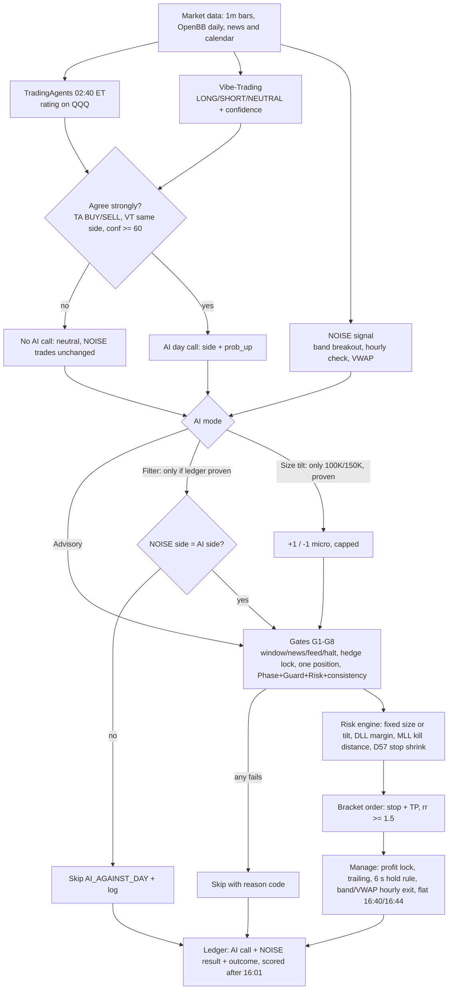

# AI Duo strategy and the "Combined with NOISE" workflow (design only, session 16)

Status: DESIGN. No code changed, nothing committed. Needs user approval before any build (CLAUDE.md: Ask before guessing on money/rules).
Facts below come from DECISIONS D53, D55, D56, D72, D74, D77, D78, `backend/app/bias/{policy,ledger,vibe_trading,ta_runner}.py`,
`signals/strategy_service.py` (`run_ai_bias`), `docs/results/session11/ai_tools_published_accuracy.md`.

## 0. What already exists (so we build on it, not twice)
- **TradingAgents** (TA, v0.7.1, `.venv-ta`, subprocess JSON via `ta_runner.py`): one daily rating (BUY/OVERWEIGHT/HOLD/UNDERWEIGHT/SELL) on the proxy ETF (QQQ for MNQ), 02:40 ET.
- **Vibe-Trading** (VT, HKUDS, `vibe-trading-ai` 0.1.19 pinned, `.venv-vt`, `make vibetrading`): the repo uses it only as a second opinion. It gets OpenBB daily context (last, change %, 20-day avg, 10 closes) and answers ONE line: LONG / SHORT / NEUTRAL + confidence 0-100 + a 25-word reason. It does not trade, size, or exit anything here.
- `bias/policy.combine` already merges them: **agree_strong** = TA is BUY or SELL, VT same side, VT confidence >= 60 (about 27% of days).
- `strategy.ai_bias` (D56) is today's AI-only button: entry 09:31 bar close, 0.5% stop, 10% safety TP, flat 16:00, 1 micro, PAPER only, default OFF. Its 10% TP is not a real R:R target and the stop is a % of price, so "AI Duo" below replaces/upgrades it (same button slot, same ledger).
- `bias/ledger.py` scores every call against the real open-to-close move. Proof rule (D55/D72): >= 30 scored calls, Wilson lower bound >= 70%, Brier < 0.25. Backfill rows (`QQQ.BF`) never count toward proof (D78).

## 1. "AI Duo" — runs separately from NOISE

**One-line idea:** trade only on the rare days when both AIs strongly agree on a side, take the first clean pullback entry in that direction, tight defined stop, at least 1.5R target, one micro.

| Item | Rule |
|---|---|
| Account | Its OWN account slot (never shares an account with NOISE; max 1 open position per account stays true). PAPER / SHADOW only. `PAYTIENCE_ALLOW_LIVE` and the Settings toggle are not enough for this strategy until section 3 gates pass. Reuses the existing PAPER_ONLY_STRATEGY guard. |
| Data | 02:40 ET: TA rates QQQ. Then VT gets OpenBB context and gives its outlook. `combine()` runs. Both outputs, raw text and the combined call are saved (BiasDecision row, label like `BUY·VT SHORT 85`). |
| Both must agree | `agree_strong` = true AND direction != 0. TA HOLD / UNDERWEIGHT-only, VT NEUTRAL, VT conf < 60, either tool failed or missing, mismatch of sides = NO TRADE (reason code stored). |
| Entry trigger | Direction comes from the AIs; TIMING comes from price (AI = WHICH SIDE, price = WHEN). Wait out the 09:30-09:35 exclusion (D11). From 09:36: first 5-min bar close that (a) pulls back to / reclaims VWAP in the AI's direction and (b) closes in that direction. Market order at the next bar open. At most 1 entry per day. A fallback of "enter at 09:31 blindly" (today's AI_BIAS) is dropped: it buys the noisiest minutes. *These trigger details are a proposal and untested.* |
| Stop | Structure stop: just beyond the pullback swing (or opening-range extreme), tick-rounded away from entry; capped at the fixed per-trade dollar risk used for NOISE ($250 emergency stop value, config, not hardcoded). If the structure stop is wider than the cap -> skip (STOP_TOO_WIDE). Stop is placed with the order (bracket), never "mental". |
| Target | TP = entry + 2.0R, floor 1.5R (config refuses rr_min < 1.5, binding). Recheck >= 1.5R after tick rounding; else skip RR_BELOW_MIN. The old 10% TP is removed. Optional (later, own test): NOISE-style profit lock (+100 pt -> stop to entry+10). |
| Size | Fixed 1 micro MNQ. No AI sizing tilt in Duo (D74 sizing is for NOISE on 100K/150K only). Risk engine still checks. |
| Times | AI call 02:40; trade window 09:36-11:30 ET (D2 morning window; later entries are lower quality and AI view is a daily view); flat before news -2 min, auto flat 16:40, hard flat 16:44, and the strategy's own time stop at 15:55-16:00 (as AI_BIAS 16:00). |
| No-trade cases | No AI key / call failed / VT failed; tools disagree; not strong; NEUTRAL day; first-5-sessions-of-stage rule; news window; calendar/feed/halt; pre-flight fail; attestation missing; DLL margin; kill switch; risk_base < $500 pause; consistency day-stop; hedge lock (below); position already open on this account; payout submitted; model-fail cooldown. Every skip stores a reason code. |
| Exits | Stop, TP, time/flat. Hold rule: app-initiated exits wait >= 6 s; protective exits (stop, TP, kill switch, breach, news, flat) never wait. A stop-modify failure flattens and pauses (never auto-resumes). Unchanged. |

### Ledger logging (every decision, including non-trades)
One row per session per proxy even when no trade, so the 30-call proof grows daily:
1. `bias_decision`: TA raw rating, VT direction/conf/reason, combined call, prob_up, agree_strong, versions (TA 0.7.1, VT 0.1.19), model name, timestamps.
2. `signal` (Duo): taken / skipped + reason code, entry, stop, TP, R:R, fill, exit reason, R result.
3. After 16:01 ET: ledger scores the call against the real open-to-close move (hit/miss, Brier). Duo trade result is stored separately, because a correct day-call can still stop out.
4. Audit trail entry for every state change; no silent failures (error -> block new entries + log + UI banner + notify).

### Conflict with NOISE on the same household (hedge lock, unchanged)
Hedge lock is household-wide EQUITY_INDEX direction: never opposite directions across accounts/profiles/instruments, and MNQ/MES share it.
- If NOISE already holds a position (or has a PENDING signal the same day) in the OPPOSITE direction, Duo does **Skip("HEDGE_LOCK")**. The AI never overrides NOISE; NOISE never waits for the AI.
- If NOISE is the same direction: Duo is allowed (separate account, no net hedge). Both rows are logged; the "agrees with NOISE" flag is stored, which is useful data.
- If Duo is open and NOISE later fires opposite: NOISE is the one blocked with HEDGE_LOCK (first position holds the lock). Tie on the same bar: NOISE wins (the verified strategy), Duo skips. This needs no change to the lock; it uses the existing check.
- Household LIVE rule stays: any account LIVE blocks household sim accounts, so Duo on paper stops when a live account is open; that is expected.

## 2. "Combined" workflow if merged with NOISE

Note: only the NOISE signal ever creates the entry in the merged version. The AI never triggers a trade by itself there (that is Duo's job, run separately). G2/G3/G5/G7/score are LunqFX-only and not used by NOISE (D77).

### Three modes (user picks; default Advisory)
| Mode | What the AI does | Evidence today | Allowed when |
|---|---|---|---|
| **Advisory** (default, live now per D72) | Logs the call, shows it on the page, changes nothing | Free; builds the ledger | Always |
| **Filter** | Blocks a NOISE entry against a strongly agreed AI day call | NOISE already goes with the day on 89% of trades (393/440, 49% win). As a block, break-even needs about 70% accuracy; at 55% it makes $7,069 vs $11,358 unfiltered; 75% -> $12,890. Published LLM next-day accuracy 50-56%. It also removes trades (light block 5-12%, heavy 20-45% and loses profit); held-out win rate +0.5 pt at most (D77). | Only after the ledger proof (>= 30 scored, Wilson LB >= 70%, Brier < 0.25), threshold `strategy.ai_gate_min_accuracy` (default 0.70). Already wired via `ledger.may_block`. |
| **Size tilt** | Agree +1 micro (cap = tier base + 1), disagree -1 (min 1), never blocks | Pays on 100K/150K at >= ~60% accuracy, loses on 25K at every accuracy, 2024-26 gains 2-3x smaller (D74) | Only 100K/150K, >= 60 scored calls with hit rate >= 60% and Brier < 0.25. Never on the 25K Pro. |

## 3. Honest status

**Unproven**
- No direction accuracy exists for either tool on index futures. TA paper: 3 stocks, 3 months, effectively in-sample; Vibe-Trading publishes none.
- No real ledger rows yet (the user's AI key is not connected). Backfill rows are "possible hindsight", never proof.
- LLM runs cannot be back-tested on past dates (hindsight leakage), so Duo has NO historical win rate or profit. Any number would be invented.
- The "pullback to VWAP" trigger, 2.0R target, structure stop and 09:36-11:30 window are proposals, not tested.
- Agree-strong fires on about 27% of days: roughly 0.3 trades/day, so ~6 trades per month. Evidence will accumulate slowly (30 calls is about 6 weeks of live days only if we count all days, but only about 8 of them would be Duo trades).
- "Both agree" may only echo the same trend any chart shows; value over price-only trend filters (D44) is unmeasured.

**Must be measured before LIVE (no LIVE before all of these)**
1. >= 30 scored live calls, Wilson LB >= 70% on the side call, Brier < 0.25 (D72); for Duo as a stand-alone strategy a higher bar: also >= 20 PAPER trades, win rate and PF >= NOISE held-out (~45% win, PF 1.3 at ~1.3R), with a 2R target needs ~38% to break even.
2. Hit rate and trade P&L tracked separately (a right day call can still lose the trade).
3. SHADOW run >= 10 sessions / 20 trades first (Lab rule), no rule/hedge/DLL violation, and the sim shows zero hedge-lock breaches against NOISE.
4. Parity test paper vs sim (same code path), reconciled, and the Live-Readiness Checklist.
5. Explicit user approval to move beyond paper ("I ACCEPT LIVE RISK" flow unchanged).

**Build steps (for later approval; nothing started)**
1. Confirm scope with user: Duo replaces `strategy.ai_bias`, or sits beside it? Confirm trade window, 2.0R target, structure stop cap, account slot.
2. Connect the AI key (TA + VT) so live ledger recording starts; keep NOISE advisory meanwhile.
3. Add `AiDuoCfg` (rr_min >= 1.5 validated, stop cap $, window, paper_only forced true) in config; no hardcoded values.
4. Pure engine function `engine/ai_duo.plan()` (trigger, structure stop, 2R TP, rr recheck) with unit tests; heartbeat-driven like NOISE.
5. `strategy_service.run_ai_duo`: reads latest BiasDecision, `combine`, gates G1/G8, hedge lock vs NOISE, one position, reason codes; flat times and exits.
6. Ledger additions: store Duo signal result, "agrees with NOISE" flag, and show "calls still needed" + Duo paper stats on the Strategy page.
7. Tests: hedge-lock conflict matrix (NOISE opposite/same/tie), paper-only enforcement, rr floor, missing-AI, fail-closed; keep 100% coverage on risk/ phases/.
8. Run in SHADOW, then PAPER, review ledger weekly; decide Filter/Size-tilt only on the proof rules above (config thresholds, never by default).
9. Save rule: write results to docs/results/, commit, rebuild bundle, republish handoff.
